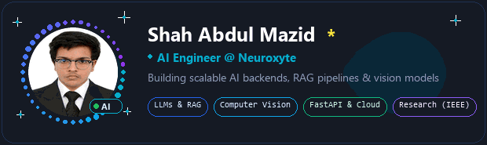
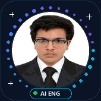

<!-- ═══════════════ ANIMATED HEADER ═══════════════ -->

<!-- Live Dynamic Waving Header -->

<!-- Live Running Typing Animation -->

 

<!-- Fast Recruiter Quick Action Badges -->

  

<!-- Cute Animated AI Engineer Showcase Card -->

---

## 🎯 Executive Summary & Recruiter Highlights

<table>
  <tr>
    <td width="28%" align="center" valign="middle">
       
      <b>Shah Abdul Mazid</b> 
      AI Engineer @ Neuroxyte  
      
    </td>
    <td width="72%" valign="top">
      <h3>🚀 Why Hire Shah Abdul Mazid?</h3>
      
Applied <b>AI Engineer at Neuroxyte</b> with a proven track record of converting cutting-edge deep learning research into resilient, production-ready enterprise AI platforms.

      <ul>
        <li>⚡ <b>Enterprise GenAI & RAG:</b> Expert in end-to-end multi-agent orchestration, hybrid semantic retrieval, vector databases, and real-time LLM inference.</li>
        <li>🧠 <b>Vision & Medical AI:</b> Published research in medical imaging with <b>92.96% test accuracy</b> and explainable Grad-CAM visualizations.</li>
        <li>🔬 <b>Peer-Reviewed Credibility:</b> First-author scientific research published in <b>IEEE (ICCIT 2025)</b> and <b>Springer (ICIDA 2025)</b>.</li>
        <li>⚙️ <b>Robust Backend Architecture:</b> High-throughput asynchronous microservices with <b>Python, FastAPI, Docker, and AWS</b>.</li>
        <li>🎓 <b>Academic Foundation:</b> B.Sc. in Computer Science & Engineering, East West University.</li>
      </ul>
    </td>
  </tr>
</table>

---

## ⚡ Intelligent Systems & Research in Action

<table align="center" width="100%">
  <tr>
    <th width="50%" align="center">🤖 Conversational AI & Multi-Agent Systems</th>
    <th width="50%" align="center">🔬 Deep Learning & Neural Architecture Research</th>
  </tr>
  <tr>
    <td align="center">
      
       
      <b>Autonomous Multi-Agent AI:</b> Enterprise RAG pipelines, dynamic tool use & conversational intelligence
    </td>
    <td align="center">
      
       
      <b>AI Research & Vision Lab:</b> Medical image segmentation, Vision Transformers & explainable AI
    </td>
  </tr>
</table>

---

## 🛠️ Technical Competencies & Skill Matrix

  

 

| Domain | Core Technologies & Frameworks |
| :--- | :--- |
| **Generative AI & LLMs** | RAG Pipelines, Multi-Agent Systems, LangChain, LlamaIndex, OpenAI API, Vector DBs (Pinecone, ChromaDB), Function Calling, Prompt Engineering |
| **Deep Learning & Vision** | PyTorch, TensorFlow, CNNs, Vision Transformers (ViT), MobDenseNet, CBAM Attention, Grad-CAM, Transfer Learning, Medical Imaging |
| **Backend & Cloud Systems** | FastAPI, Python (AsyncIO), RESTful Microservices, Docker, AWS (EC2, S3), Redis, PostgreSQL, MongoDB, CI/CD Actions |
| **Research & Analytics** | Statistical Modeling, Epistemic Uncertainty Estimation, Model Interpretability, NumPy, Pandas, Scikit-learn, OpenCV |

---

## 🚀 Featured Engineering & Research Projects

### 01. Nexus Enterprise Intelligence Platform
*Enterprise knowledge assistant powered by RAG, LLMs, and multi-agent workflows.*

- **Problem:** Enterprise siloed documents require instant, highly accurate contextual synthesis without hallucination.
- **Solution:** Architected a modular knowledge assistant using hybrid vector retrieval (Pinecone), OpenAI LLMs, and multi-agent coordination.
- **Stack:** `FastAPI` • `Next.js` • `Pinecone` • `OpenAI API` • `Docker`
- 🔗 [Explore Repository](https://github.com/Shah-Abdul-Mazid/Nexus-Enterprise-Intelligence-Platform)

---

### 02. Brain Tumor Classification with Explainable AI
*High-precision medical diagnosis using MobDenseNet + CBAM Attention.*

- **Achievement:** Achieved a reported test accuracy of **92.96%** on clinical brain MRI datasets.
- **Explainability:** Integrated Grad-CAM attention visual heatmaps to give clinicians full interpretability into model decisions.
- **Stack:** `PyTorch` • `Computer Vision` • `Grad-CAM` • `Transfer Learning`

---

### 03. MangoStack: A Lightweight Ensemble for Real-Time Diagnosis
*Edge-deployable deep ensemble for real-time agricultural pathology.*

- **Status:** **Published Peer-Reviewed Research — IEEE ICCIT 2025**
- **Impact:** Designed an ultralightweight, interpretable architecture optimized for resource-constrained edge devices with high diagnostic fidelity.
- 📄 [View IEEE Publication DOI](https://doi.org/10.1109/ICCIT68739.2025.11490181)

---

### 04. Uncertainty-Aware Chest Pathology Detection
*Vision and Language Transformers with epistemic uncertainty estimation.*

- **Status:** **Published Peer-Reviewed Research — Springer ICIDA 2025**
- **Impact:** Formulated a dual-transformer architecture pairing visual radiographs with linguistic reports to deliver uncertainty-calibrated diagnostic predictions.
- 📄 [View Springer Publication DOI](https://doi.org/10.1007/978-3-032-27845-6_34)

---

## 📚 Publications & Scientific Footprint

  
  
  

1. **MangoStack: A Lightweight, Interpretable Ensemble for Real-Time Mango Leaf Disease Diagnosis**  
   *IEEE International Conference on Computer and Information Technology (ICCIT), 2025* · [DOI: 10.1109/ICCIT68739.2025.11490181](https://doi.org/10.1109/ICCIT68739.2025.11490181)

2. **Uncertainty-Aware Chest Pathology Detection with Vision and Language Transformers**  
   *Springer International Conference on Intelligent Computing & Data Analysis (ICIDA), 2025* · [DOI: 10.1007/978-3-032-27845-6_34](https://doi.org/10.1007/978-3-032-27845-6_34)

---

## 🐍 Contribution Velocity & GitHub Analytics

  <!-- Live Snake Animation -->
  

 

  
  
    
  

---

## 💼 Open to Opportunities — Let's Connect!

I am actively open to discussing **Full-Time AI Engineering roles**, **GenAI / LLM Solutions**, and **Deep Learning Research collaborations**.

  
  
  

  

